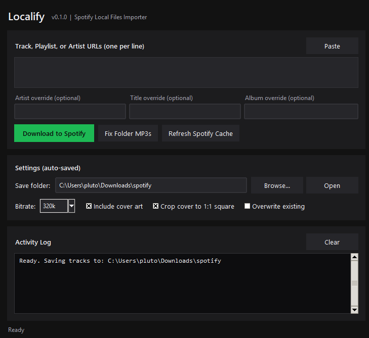

# localify

A cross-platform desktop app and CLI tool to import non-DRM audio tracks with embedded cover art and ID3v2.3 metadata directly into Spotify Local Files.

**[Download Windows `.exe` (Latest Release)](https://github.com/yawuis/localify/releases/latest)**



## Features

- **Zero-setup Windows `.exe`:** Double-click `localify-windows.exe` with no Python, Node.js, or API keys required. If `ffmpeg` is not installed yet, Localify downloads and configures it automatically in one click.
- **Multi-platform support:** Works with SoundCloud, YouTube, YouTube Music, Bandcamp, Mixcloud, and other non-DRM sources supported by `yt-dlp`.
- **Spotify-compatible MP3 output:** Re-encodes audio to genuine 44.1 kHz MP3 (`libmp3lame`, 320 kbps default) so Spotify never greys out tracks with the `1193046:28:15` duration error.
- **Smart title cleanup & cover art:** Automatically strips noisy upload tags like `(Official Audio)` and duplicate artist prefixes, embeds custom or automatic cover art, and center-crops thumbnails to 1:1 square JPEGs.
- **Built-in local MP3 tag & cover editor:** Edit Title, Artist, Album, or swap cover art on any existing `.mp3` in your Spotify folder without re-encoding audio.
- **Atomic staging:** Downloads and encodes in a temporary directory before moving finished `.mp3` files into your Spotify folder, preventing Spotify from caching `.part` or `.tmp` ghost entries.
- **Broken MP3 fixer:** Scan a folder and repair `.mp3` files that are actually M4A, AAC, Opus, or WebM containers.
- **Spotify cache reset:** Clear stale `local-files.bnk` caches on Windows, macOS, and Linux.

## Quick Start

### Windows (Standalone `.exe`)

1. Download `localify-windows.exe` from [GitHub Releases](https://github.com/yawuis/localify/releases/latest).
2. Double-click it. If `ffmpeg` is not already installed, click **Install FFmpeg** (or just start a download and Localify installs it automatically).
3. Paste any SoundCloud, YouTube, or Bandcamp URL and click **Download to Spotify**.

### From Source (Windows, macOS, Linux)

Requires Python 3.10+ and `ffmpeg`/`ffprobe` (`brew install ffmpeg` on macOS, `sudo apt install ffmpeg` on Debian/Ubuntu, or automatic on Windows):

```bash
git clone https://github.com/yawuis/localify.git
cd localify
pip install .
localify
```

## CLI Usage

### Terminal interactive mode

```bash
localify cli
```

### Download directly

```bash
localify "https://soundcloud.com/artist/track"
localify "https://www.youtube.com/watch?v=..." --artist "Artist Name" --title "Track Title" --cover "cover.jpg"
localify "https://artist.bandcamp.com/album/album-name" --bitrate 320k
```

Options:
- `-o, --output DIR` — Override destination folder
- `-b, --bitrate RATE` — Target MP3 bitrate (default: `320k`)
- `--artist`, `--title`, `--album` — Override ID3 tags
- `--cover PATH` — Embed a custom local image as cover art
- `--no-cover` — Skip embedding cover art
- `--no-crop` — Keep original cover aspect ratio instead of 1:1 square crop
- `--no-clean-title` — Keep original title without stripping upload tags
- `--overwrite` — Replace existing `.mp3` files with the same name

### Edit tags or cover art on an existing MP3

```bash
localify tag "C:\Users\you\Music\Spotify Local Files\track.mp3" --title "Song" --artist "Artist" --cover "cover.jpg"
```

### Configure defaults

```bash
localify config --output "C:\Users\you\Music\Spotify Local Files" --bitrate 320k --embed-cover true --square-cover true --clean-titles true
localify config
```

### Repair existing broken local files

```bash
localify fix --dry-run
localify fix
localify fix "/path/to/local/files"
```

### Reset Spotify's local files cache

Quit Spotify, run:

```bash
localify refresh-spotify
```

Then reopen Spotify.

## Building the Windows `.exe` Locally

```powershell
pip install -e ".[build]"
.\scripts\build_exe.ps1
```

The standalone executable is written to `dist\localify.exe`.

## Notes

- DRM-protected streams (such as SoundCloud Go+ encrypted tracks) are not supported and will be skipped with a clear error message.
- Make sure your configured output folder is added under **Spotify Settings > Local Files > Show songs from**.

## License

MIT
